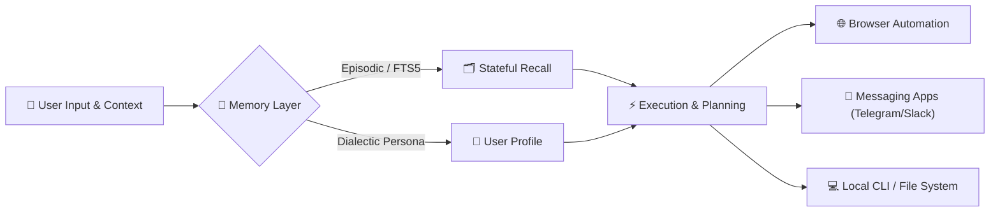

  

# 🤖 Awesome Personal AI Agents 

  
  
  
  
  
  

---

## 🧭 Overview & Ecosystem Definition

A curated directory of **Personal AI Agents**, autonomous executive assistants, and self-hosted intelligence stacks. Unlike conventional stateless chatbots, **Personal AI Agents** act autonomously on your behalf across digital environments, retain stateful long-term memory, learn your habits, and execute multi-step workflows across applications, browsers, operating systems, and messaging networks.

> **Key Capabilities:** Continuous Episodic Memory • Cross-Session User Modeling • Autonomous Web & Desktop Actions • Omnichannel Messaging (SMS, WhatsApp, Slack, Telegram) • Self-Improving Skill Loops • Privacy-First Local Deployments.

---

## 📑 Table of Contents

- [📊 Sector Overview & Market Dynamics](#-sector-overview--market-dynamics)
- [☁️ SaaS / Hosted Platforms](#️-saas--hosted-platforms)
- [💻 Open-Source GitHub Projects](#-open-source-github-projects)
- [🧩 Architecture & Core Capabilities](#-architecture--core-capabilities)
- [🤝 How to Contribute](#-how-to-contribute)
- [⚠️ Disclaimer & Security](#️-disclaimer--security)
- [📈 Star History](#-star-history)
- [💖 Support & Community](#-support--community)

---

## 📊 Sector Overview & Market Dynamics

- **Estimated Market Size**: The global autonomous AI agents sector is estimated at **$5.1B–$8.8B** and is projected to expand to **$47B–$52B+ by 2030**, compounding at an extraordinary annual growth rate (CAGR) of **~42%–45%**.
- **Market Dynamics & Structure**: The sector is **moderately fragmented** rather than winner-take-all. While frontier foundational model providers (OpenAI, Anthropic, Google) dominate the underlying model layer, personal agents require specialized capabilities—such as stateful episodic memory, wearable ambient audio capture, browser-use automation, local confidential computation, and multi-app orchestration. As a result, agile SaaS innovators and open-source self-hosted ecosystems continue to compete across distinct high-value niches without a single monopolistic gatekeeper.

---

## ☁️ SaaS / Hosted Platforms

The table below lists top managed and hosted SaaS personal AI agent platforms, sorted in descending order by **Company Valuation / Size**:

| Platform / Product | Valuation / Revenue (Size) | Starting Pricing | Free Tier Limit | Core Capabilities & Highlights |
| :--- | :--- | :--- | :--- | :--- |
| **[Granola](https://www.granola.ai/)** | **$1.5B Valuation** *(Raised $192M total; Series C led by Index Ventures)* | **$14 / user / month** *(Granola Business; annual discount available)* | **Free forever**: Unlimited notes/meetings viewable within a rolling 30-day history window; full AI chat & customizable templates included | AI notepad & meeting copilot with local audio capture (no meeting bots); synthesizes conversation context into structured follow-ups and CRM updates. |
| **[Limitless AI](https://www.limitless.ai/)** *(formerly Rewind)* | **$350M Valuation** *(Acquired by Meta Platforms; $33M VC raised prior)* | **$19 / month** *(Pro tier billed annually, or $29/mo billed monthly)* | **Free forever**: 1,200 audio transcription minutes/month (20 hrs/mo) & baseline memory search across meetings and browser history | Continuous ambient audio capture and memory augmentation; integrates with wearable Pendant hardware to record, transcribe, and index daily discussions. |
| **[Lindy AI](https://www.lindy.ai/)** | **~$150M–$200M Valuation** *(Raised $54M VC funding; ~$5.2M ARR)* | **$49.99 / user / month** *(Plus plan; 3,000 standard monthly credits)* | **7-day free trial**: Full access to Plus/Pro features loaded with $50 worth of trial credits; credit-metered execution | Omnichannel personal executive assistant reachable via SMS, WhatsApp, and email; automates calendar scheduling, inbox triage, and multi-app workflows across 100+ integrations. |
| **[MultiOn](https://www.multion.ai/)** | **~$100M Valuation** *(Raised $20M Series A led by General Catalyst)* | **$29 / month** *(Pro plan; elevated concurrency and speed)* | **Free forever**: 10 autonomous agent tasks per day (up to ~300 tasks/month) with local Chrome extension access | Autonomous browser-use agent platform; navigates websites, bypasses anti-bot barriers, fills forms, and completes multi-step web operations on user command. |
| **[Personal AI](https://www.personal.ai/)** | **~$50M Valuation** *(Raised $21.9M total from Supernode Global & BDev)* | **$40 / month** *(Elevate plan; personal model training & memory)* | **14-day free trial**: Access to create a digital persona with up to 500 stateful memory blocks and messaging integrations | Patented stateful memory engine that models user communication styles, personal facts, and knowledge bases for individualized response synthesis (SOC 2 & HIPAA certified). |
| **[Khoj Cloud](https://khoj.dev/)** | **~$8M–$10M Valuation** *(Raised $1.5M seed; Y Combinator alumni)* | **$24 / month** *(Cloud Pro plan; $16/mo billed annually)* | **Free forever**: 200 AI messages/month, unlimited local document indexing, and web search integration | Personal AI second brain; searches across personal notes, PDF files, and Markdown documentation with deep reasoning and automated scheduled queries. |

---

## 💻 Open-Source GitHub Projects

Explore the leading open-source personal AI agents and autonomous frameworks, sorted in descending order by **GitHub Stars_Count**:

| Project | GitHub_Stars | Primary Focus & Architecture Highlights |
| :--- | :---: | :--- |
| **[Hermes Agent](https://github.com/NousResearch/hermes-agent)** |  | **Autonomous Self-Improving Personal Agent**: Backed by Nous Research; features a closed continuous learning loop, cross-session FTS5 memory, Honcho dialectic user modeling, 7 sandbox terminal backends, and 20+ messaging integrations (Telegram, Discord, WhatsApp, Signal). |
| **[AutoGPT](https://github.com/Significant-Gravitas/AutoGPT)** |  | **Autonomous Agent Benchmark**: General-purpose autonomous agent architecture capable of decomposing goals, executing code, managing multi-step web searches, and running modular agentic workflows. |
| **[Dify](https://github.com/langgenius/dify)** |  | **Agentic Workflow & RAG Platform**: Visual canvas to orchestrate personal AI assistants, knowledge retrieval pipelines, tool execution nodes, and self-hosted model deployments via Docker Compose. |
| **[Browser Use](https://github.com/browser-use/browser-use)** |  | **Browser Automation Engine**: Open-source Python library enabling AI agents to interact with web pages, parse DOM trees, input text, click elements, and extract structured web data. |
| **[OpenHands](https://github.com/OpenHands/OpenHands)** |  | **Autonomous Software Development Agent**: Executes code, browses files, edits projects, and automates desktop development workflows inside containerized sandboxes. |
| **[Khoj](https://github.com/khoj-ai/khoj)** |  | **Self-Hosted AI Second Brain**: Connects to desktop files, Obsidian, Emacs, and Notion; indexes documents with local vector search and responds via local (Ollama/Llama) or cloud LLMs. |
| **[Letta](https://github.com/letta-ai/letta)** |  | **Stateful Memory Agent Framework**: Formerly MemGPT; equips LLMs with hierarchical operating-system-inspired memory (core memory, archival memory, and recall storage) for perpetual statefulness. |
| **[BabyAGI](https://github.com/yoheinakajima/babyagi)** |  | **Task-Driven Autonomous Agent**: Seminal minimalist autonomous task management system executing recursive task creation, prioritization, and completion loops. |
| **[ElizaOS](https://github.com/elizaOS/eliza)** |  | **Autonomous Multi-Agent Social OS**: Lightweight conversational agent framework supporting Discord/Twitter connectors, character cards, document retrieval, and persistent state. |
| **[Atomic Agent](https://github.com/AtomicBot-ai/atomic-agent)** |  | **Local-First CLI Agent**: Fast terminal assistant optimized for local open-weight LLMs, system commands, and script execution without external data leaks. |
| **[SwarmClaw](https://github.com/swarmclawai/swarmclaw)** |  | **Multi-Agent CLI Runtime**: Coordinates lightweight specialist CLI agents working collaboratively on engineering tasks and batch automations. |
| **[OpenAcme](https://github.com/sandydasari/openacme)** |  | **Role-Specialized Agent Workforce**: TypeScript platform orchestrating distinct personal agents across life domains with MCP tooling, web dashboards, and CLI interfaces. |
| **[OpenHermit](https://github.com/HCF-STUDIOS/openhermit)** |  | **Long-Running Agent Daemon**: Deploys agent fleets as background daemons with persistent event loops and scheduled trigger execution. |
| **[5dive](https://github.com/5dive-ai/5dive)** |  | **Personal Agent Organization**: Host a private collective of named agents on local servers to distribute research, scheduling, and writing tasks. |
| **[Hivekeep](https://github.com/MarlBurroW/hivekeep)** |  | **Self-Hosted Personal Agent Team**: MIT-licensed platform running a persistent crew of home AI agents coordinating autonomously for an individual user. |

---

## 🧩 Architecture & Core Capabilities

When evaluating a personal AI agent platform, consider these four structural dimensions:

1. **Memory & User Modeling**: Does the agent retain cross-session facts, update past beliefs, and adapt to your communication tone (e.g., Letta, Hermes Agent, Personal AI)?
2. **Execution Scope**: Can the agent browse the live web, submit forms, execute sandboxed code, or trigger local shell commands (e.g., MultiOn, Browser Use, OpenHands)?
3. **Omnichannel Interface**: Can you reach the assistant through everyday messaging channels (SMS, WhatsApp, Discord, Telegram) without opening a separate IDE or browser window (e.g., Lindy, Hermes Agent)?
4. **Data Ownership & Privacy**: Is user data stored on private infrastructure / local storage, or does it depend on proprietary hosted cloud storage (e.g., Khoj, Hivekeep vs. Granola, Limitless)?

---

## 🤝 How to Contribute

Contributions are warmly encouraged! To submit a new SaaS platform or open-source repository:

1. 🍴 **Fork the repository** on GitHub.
2. 🌿 **Create a feature branch**: `git checkout -b feat/add-agent-name`.
3. 📝 **Edit `README.md`**: Follow existing table and list structures. Include exact pricing, free-tier limitations, and GitHub Stars_Badges (`style=social&color=white`).
4. 🔎 **Verify details**: Ensure links point to official websites/repositories and claims are factual.
5. 🚀 **Submit a Pull Request** with a concise description of why the tool belongs in this curated collection.

---

## ⚠️ Disclaimer & Security

- **Independent Community Curation**: This repository is maintained for research and educational purposes. Inclusion does not imply official endorsement.
- **Privacy & Credential Safety**: Personal AI agents often require elevated permissions (email inbox tokens, browser sessions, CLI access). Always run untrusted agents in sandboxed environments (Docker, VMs, Modal/Daytona) and protect credential vaults.
- **Data Persistence**: When hosting open-source agents locally, ensure regular automated backups of your SQLite/vector memory stores to prevent accidental data loss.

---

## 📈 Star History

---

## 💖 Support & Community

Thank you for visiting and supporting **Awesome Personal AI Agents**! If you find this directory valuable, please take a moment to support the project:

- ⭐ **Star this repository** to help others discover it.
- 🍴 **Fork and contribute** your favorite personal AI agent setups.
- 📢 **Share with fellow AI engineers and enthusiasts** on Twitter/X, LinkedIn, and Discord.
- ☕ **Buy me a coffee**: Support ongoing curation and open-source maintenance via the [GitHub Sponsors Dashboard](https://github.com/sponsors/ishandutta2007).

  

---

  Maintained with ❤️ by <a href="https://github.com/ishandutta2007">Ishan Dutta</a> and the open-source AI community.

